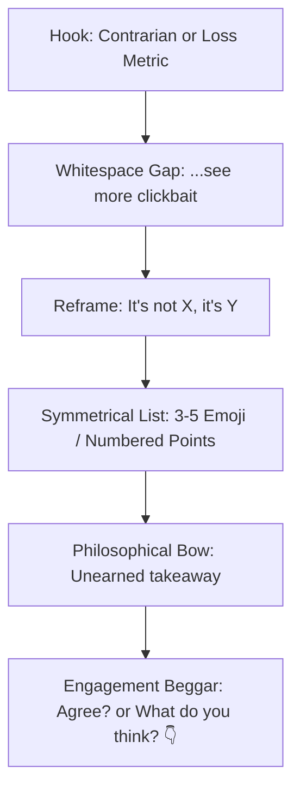

# AI-Generated Social Post Tells (2025–2026 Edition)
**Context:** Research and empirical catalog for *Slop Shame* (Chrome Extension for LinkedIn)  
**Date:** October 2026  
**Scope:** Characteristics of AI-generated social media posts (LinkedIn focus), ghostwriting templates (Taplio, AuthoredUp, Supergrow, EasyGen), frontier model shifts (Claude 3.5/3.7, GPT-4o, o1/o3), cheap stylometrics, and false-positive risk mitigations.

---

## Executive Summary & Landscape (2025–2026)

On LinkedIn, AI-generated text ("slop") has saturated the feed. Studies by AI detection platforms like [Originality.ai](https://originality.ai/blog/linkedin-ai-content-study) and [GPTZero](https://gptzero.me/news/ai-vision) indicate that between 75% and 81% of sampled long-form LinkedIn posts contain high-confidence AI hallmarks. 

Between 2023 and 2026, the signature of AI slop underwent an evolution:
1. **2023–2024 ("The ChatGPT Awakening"):** Characterized by Latinate corporate jargon (*delve*, *testament*, *tapestry*, *foster*, *beacon*, *revolutionize*), mechanical 5-point emoji bullet lists, and raw copy-paste leaks (*"Certainly! Here is an engaging post..."*).
2. **2025–2026 ("The Thought-Leader & Claudism Era"):** Driven by newer frontier models (Claude 3.5 Sonnet / Opus, GPT-4o, reasoning models) and LinkedIn ghostwriting platforms (Taplio, Supergrow, EasyGen, AuthoredUp). Slop shifted from academic/corporate stiffness to **manufactured conversational intimacy** and **insight-signaling**: obsessive use of architectural and intellectual metaphors (*load-bearing*, *the real unlock*, *quietly*, *genuinely*, *worth sitting with*), punchy single-clause sentences, and heavy reliance on em dashes (`—`).

---

## 1. Phrase-Level Tells (Openers, Transitions, Closers, Vocabulary)

Every item below includes an estimated detection strength (**Strong** = smoking gun / high weight; **Medium** = clear tell in combination; **Weak** = faint tell / frequent in corporate speak), concrete examples, and source documentation.

### 1.1 Openers & Hooks

| Tell / Pattern | Strength | Frequency | Example Text | Source URL |
| :--- | :--- | :--- | :--- | :--- |
| **"In today's fast-paced / ever-evolving [landscape/world]..."** | Strong | High | *"In today's fast-paced, hyper-connected digital landscape, leaders often forget one simple truth:"* | [Originality.ai](https://originality.ai/blog/chatgpt-words-phrases) / [Reddit r/copywriting](https://www.reddit.com/r/copywriting/) |
| **The Fake Introspective Hook ("I almost didn't post this...")** | Medium | High | *"I hesitated to share this. But last Tuesday at 2 AM, everything shifted."* | [CommentRocket](https://commentrocket.com) / [r/LinkedInLunatics](https://www.reddit.com/r/LinkedInLunatics/) |
| **The Contrarian Absolutist Hook ("Most people think X. They're dead wrong.")** | Medium | Very High | *"Most people believe productivity is about time management. That is completely backwards."* | [Taplio Viral Templates](https://taplio.com) / [Supergrow](https://supergrow.ai) |
| **The "Let's unpack / dive into" Opener** | Strong | High | *"Let's unpack why 99% of B2B outbound campaigns fail before they even start."* | [ExplainX AI](https://explainx.ai) / [Reddit r/ChatGPT](https://www.reddit.com/r/ChatGPT/) |
| **The Curated Authority Lie ("I spent [X hours / $$] so you don't have to")** | Medium | Very High | *"I spent 45 hours dissecting the top 100 SaaS pricing pages. Here is the blueprint:"* | [EasyGen](https://easygen.io) / [Taplio](https://taplio.com) |
| **Prompt Echo / Bot Leak Openers** | Strong (Definitive) | Low-Med | *"Certainly! Here is an engaging, high-reach LinkedIn post tailored for your audience:"* | [r/LinkedInLunatics Leak Thread](https://www.reddit.com/r/LinkedInLunatics/) |

### 1.2 Rhetorical Pivots & Transitions

| Tell / Pattern | Strength | Frequency | Example Text | Source URL |
| :--- | :--- | :--- | :--- | :--- |
| **The Dramatic Single-Line Pivot ("Here's the thing:" / "Here's the kicker:")** | Medium | Very High | *"Here's the kicker:*<br><br>*None of the metrics actually mattered."* | [PlusAI](https://plusai.com) / [Developers Digest](https://developersdigest.tech) |
| **The Negation-Antithesis Pivot ("It's not about X. It's about Y.")** | Medium | Very High | *"Leadership isn't about having all the answers—it's about asking the right questions."* | [The Walrus](https://thewalrus.ca) / [GPTZero Patterns](https://gptzero.me) |
| **The Ponderous Imperative ("Let that sink in.")** | Strong | Medium | *"You don't have a traffic problem. You have a clarity problem. Let that sink in."* | [Reddit r/LinkedInLunatics](https://www.reddit.com/r/LinkedInLunatics/) |
| **The Sycophantic Self-Correction ("And honestly? That's okay.")** | Medium | High | *"We missed our Q3 forecast. And honestly? It was the best thing that ever happened to our culture."* | [Polytranslator Claudisms](https://polytranslator.com) |
| **The False Concession ("To be fair, ..." / "That's not to say...")** | Weak | High | *"To be fair, traditional marketing had its run. But the landscape has permanently shifted."* | [Developers Digest](https://developersdigest.tech) |

### 1.3 Closers & Engagement Calls to Action (CTAs)

| Tell / Pattern | Strength | Frequency | Example Text | Source URL |
| :--- | :--- | :--- | :--- | :--- |
| **The Naked One-Word "Agree?"** | Strong | High | *"True culture is how you treat people when numbers are down.*<br><br>*Agree?"* | [r/LinkedInLunatics](https://www.reddit.com/r/LinkedInLunatics/) |
| **The Formulaic Double-Question + Finger Down Emoji** | Strong | Very High | *"What's your biggest challenge with retention in 2026? Drop your perspective in the comments below! 👇"* | [Originality.ai](https://originality.ai) / [Supergrow](https://supergrow.ai) |
| **The Unearned Moral Wrap-Up ("Ultimately, it serves as a reminder...")** | Strong | High | *"Ultimately, technology is just a tool. The human element will always be the cornerstone of growth."* | [Windmill Growth](https://windmillgrowth.com) / [Copyleaks](https://copyleaks.com) |
| **The Repost/Bookmark Hustle** | Medium | High | *"Found this valuable? ♻️ Repost to help a colleague in your network, and save for later."* | [AuthoredUp Templates](https://authoredup.com) |

### 1.4 The "ChatGPT Bingo" Lexical Hallmarks

Single words are rarely sufficient for a flag, but dense clustering of these words within 100–200 tokens indicates high statistical probability of LLM generation:

* **Tier 1 (High Confidence Tells - Rare in natural social speech):**
  * *Delve* (the canonical LLM tell)
  * *Tapestry* ("a rich tapestry of collaboration")
  * *Testament* ("stands as a testament to...")
  * *Beacon* ("a beacon of hope / innovation")
  * *Labyrinth* ("navigating the labyrinth of...")
  * *Crucible* ("forged in the crucible of...")
* **Tier 2 (Corporate LLM Staples - Over-represented by 400%+ vs human baseline):**
  * *Landscape* ("in the modern SaaS landscape")
  * *Foster* ("foster genuine alignment")
  * *Harness* ("harness the transformative power of...")
  * *Unlock / Unleash* ("unlock your team's hidden potential")
  * *Elevate / Supercharge* ("elevate your personal brand")
  * *Pivotal / Paramount* ("a pivotal juncture")
  * *Holistic / Robust / Seamless* ("a holistic, robust architecture")
* **Tier 3 (Formal Academic Connectors misplaced in social media):**
  * *Furthermore, moreover, hence, thus, subsequently, in summary*

*(Sources: [Originality.ai ChatGPT Vocabulary Tracker](https://originality.ai/blog/chatgpt-words-phrases); [Reddit r/ChatGPT Community Blacklist](https://www.reddit.com/r/ChatGPT/)).*

---

## 2. Structural & Format Tells

Human writing is noisy, uneven, and typo-tolerant. AI writing generated directly or passed through LinkedIn optimizers adheres strictly to visually recognizable geometric patterns.

### 2.1 The "Broetry" Spatial Architecture
* **Tell:** Every sentence or short clause is isolated by a full empty line (`\n\n`), creating an ultra-vertical, low-density column of text designed to maximize mobile scroll height and game the `...see more` dwell-time algorithm.
* **Format:**
  ```text
  Hook sentence.

  One-line complication.

  A dramatic turn.

  Here's what changed:
  ```
* **Detection Heuristic:** Ratio of blank lines to non-empty lines $> 0.65$; average words per paragraph $< 14$.
* **Strength:** **Medium** (High frequency in human growth hacks, but combined with AI vocabulary it is an overwhelming signal; see Section 5 for the human pioneer caveat).
* **Source:** [Fenwick Media: The History of Broetry](https://fenwick.media) / [The Daily Beast](https://thedailybeast.com).

### 2.2 Symmetrical Emoji Bullets
* **Tell:** Lists of 3, 5, or 7 items where *every single bullet* begins with an emoji matching the semantic theme of the bullet point, followed by bold text and an imperative colon clause.
* **Format:**
  ```text
  🚀 Growth: Scaling outbound without headcount
  💡 Clarity: Defining your core ICP
  📈 Leverage: Automating customer onboarding
  🎯 Focus: Saying no to non-core features
  ```
* **Detection Heuristic:** 3 or more consecutive lines matching `^[\p{Extended_Pictographic}]\s+(?:\*\*|[\u{1D400}-\u{1D7FF}]+)?[A-Za-z0-9\s]+:?`.
* **Strength:** **Strong** (Raw humans rarely maintain consistent emoji-bullet pairing across an entire post).
* **Source:** [Originality.ai Social Media Tracker](https://originality.ai) / [GPTZero 10 AI Patterns](https://gptzero.me).

### 2.3 Unicode Bold & Mathematical Alphanumeric Characters
* **Tell:** Posts using Unicode glyphs from the Mathematical Alphanumeric Symbols block (`U+1D400` to `U+1D7FF`) to mimic bold or italic formatting (e.g., `𝗧𝗵𝗶𝘀 𝗶𝘀 𝗯𝗼𝗹𝗱` or `𝟱 𝗞𝗲𝘆 𝗟𝗲𝘀𝘀𝗼𝗻𝘀`).
* **Origin:** LinkedIn's standard post composer does not support Markdown `**bold**`. AI growth tools (Taplio, Typegrow, Hyperclapper) and copy-paste prompt workflows automatically convert headers via Unicode converters (YayText, LingoJam).
* **Detection Heuristic:** Scan for non-ASCII math alphabets `[\u{1D400}-\u{1D7FF}]` in strings of $> 3$ characters.
* **Strength:** **Strong** (Nearly 100% correlated with automated ghostwriting tools or growth-hacker AI schedulers).
* **Accessibility Note:** Screen readers read these character-by-character as *"Mathematical Bold Capital T..."*, making them heavily criticized in UX accessibility circles.
* **Source:** [LinkedIn Makeover: The Dangers of Unicode Text](https://linkedin-makeover.com) / [Typegrow](https://typegrow.com).

### 2.4 Em-Dash Hyper-Saturation (`—`)
* **Tell:** LLMs—particularly Anthropic's Claude and OpenAI's GPT-4o—use em dashes at a frequency 5x–10x higher than average human social copy. They replace commas, colons, or clean period stops to create artificial dramatic cadence.
* **Format:** *"True leadership isn't about metrics—it's about empathy—and when things go wrong—it's about accountability."*
* **Detection Heuristic:** Ratio of em dashes (`—` or `U+2014` / `U+2013`) to sentence count $> 0.4$, or multiple em dashes inside a single sentence.
* **Strength:** **Medium-Strong**.
* **Source:** [The Walrus: Why AI Loves Em Dashes](https://thewalrus.ca) / [Edward Sturm Stylometrics](https://edwardsturm.com).

### 2.5 Symmetrical "Rule of Three" Parallelism
* **Tell:** Bulleted items, takeaways, or advice blocks that have almost identical syllable or character counts, identical verb conjugations (gerunds or imperatives), and identical syntactic layouts.
* **Human vs. AI Contrast:** Humans naturally run out of steam, adding one long bullet and one short afterthought; AI outputs perfectly balanced triplets.
* **Strength:** **Medium**.
* **Source:** [GPTZero Patterns Breakdown](https://gptzero.me).

### 2.6 The Low-Entropy Hashtag Cluster
* **Tell:** A tidy block of 3–5 generic, high-volume hashtags appended at the very end of the post, formatted with title casing.
* **Format:** `#Leadership #Innovation #ArtificialIntelligence #Entrepreneurship #PersonalGrowth`
* **Strength:** **Weak-Medium** (Both humans and AI tools do this, but AI generators default to these exact 5 top tags).
* **Source:** [Supergrow LinkedIn Guide](https://supergrow.ai).

---

## 3. Newer-Model Tells (2025–2026: Claude 3.5/3.7, GPT-4o, Reasoning Models)

As older vocabulary like *delve* and *tapestry* became widely mocked, users shifted to newer models (Claude 3.5 Sonnet, GPT-4o, OpenAI o1/o3). In doing so, a brand-new dialect of AI slop emerged: **"Claudisms"** and **"Earnest Thought-Leader Slop."**

These terms were reinforced through RLHF (Reinforcement Learning from Human Feedback) because human annotators rewarded models for sounding thoughtful, analytical, and humble.

### 3.1 The 2025–2026 Lexical Catalog

| Tell / Phrase | Origin / Engine | Strength | Context / Why It's Overused | Example |
| :--- | :--- | :--- | :--- | :--- |
| **"Load-bearing"** | Claude (Anthropic) | **Strong** | The quintessential Claudism. Imported from architecture into strategy, software, and human emotion to signal structural necessity. | *"That third bullet point is deliberate and load-bearing."* / *"The CEO's apology wasn't PR—it was load-bearing."* |
| **"The real unlock" / "That's the unlock"** | Claude & GPT-4o | **Strong** | Replaced "game-changer." Used at the climax of an analysis to frame an obvious point as an insider secret. | *"Automating the workflow is nice, but aligning incentives is the real unlock."* |
| **"Quietly"** | Claude & GPT-4o | **Medium-Strong** | Manufactured understatement. Frames an open trend as a subtle, profound shift only observed by the author. | *"Quietly, small open-source models are eating enterprise software."* / *"What quietly matters most is..."* |
| **"Genuinely"** | Claude / System prompts | **Medium** | Conversational intensifier designed to project faux intellectual sincerity and humility. | *"This was a genuinely hard lesson to internalize."* / *"I am genuinely curious how other founders solve this."* |
| **"Worth sitting with"** | Claude | **Strong** | Pseudo-philosophical injunction at the end of a thought-piece. | *"That distinction is worth sitting with."* |
| **"And that's not nothing" / "That's not trivial"** | Claude | **Strong** | Litotes (affirming by denying the opposite) used to hedge while asserting value. | *"We saved 4 hours a week. And that's not nothing."* |
| **"Lands cleanly"** | Claude / Tech critique | **Strong** | Shorthand for an argument or product pitch resonating smoothly. | *"Notice how that value proposition lands cleanly with enterprise buyers."* |
| **"The seam between..."** | Claude | **Medium-Strong** | Used to describe system boundaries or conceptual friction points. | *"The friction lives entirely in the seam between design and execution."* |
| **"Belt and suspenders"** | Claude | **Medium** | Overused metaphor for redundancy in planning or engineering. | *"It sounds like overkill, but you need a belt-and-suspenders approach."* |
| **"Here's the kicker"** | GPT-4o | **Medium-Strong** | Conversational narrative hook preceding a dramatic contrast or reveal. | *"Here's the kicker: we didn't spend a single dollar on paid ads."* |
| **"That's the whole point"** | GPT-4o / Claude | **Medium** | Abrupt rhetorical dismissal of counterarguments to sound decisive. | *"It feels uncomfortable? Good. That's the whole point."* |
| **"Step-function change"** | Silicon Valley / LLMs | **Medium** | Tech jargon adopted as default LLM synonym for dramatic improvement. | *"Generative workflows represent a step-function change for marketing teams."* |

*(Sources: [DevelopersDigest Tech Claudisms Catalog](https://developersdigest.tech); [ExplainX AI Research](https://explainx.ai); [Polytranslator Claudisms](https://polytranslator.com); [Hacker News Claude Style Discussions](https://news.ycombinator.com)).*

---

## 4. LinkedIn Ghostwriting Tool Templates (Taplio, Supergrow, EasyGen, AuthoredUp)

Commercial AI tools tailored for LinkedIn don't just prompt raw models—they run prompt wrappers and swipe-file templates reverse-engineered from viral posts. Understanding these templates makes them trivially easy to detect with rule-based heuristics.

### 4.1 The Core Ghostwriting Formulas



#### Template A: The "Contrarian Pivot" (Taplio & Supergrow)
* **Structure:**
  1. Universal consensus statement.
  2. One-word or short fragment rejection: *"Wrong."* or *"Stop doing this."*
  3. Reframe.
  4. Numbered tactical takeaway.
* **Example:**
  > *"Posting 7 days a week is how you grow on LinkedIn.*  
  >  
  > *Wrong.*  
  >  
  > *It's how you burn out and destroy your reputation.*  
  >  
  > *Here is the 2-post-per-week flywheel that drove $85,000 in inbound pipeline:"*

#### Template B: The "Vulnerability Teardown / From X to Y" (AuthoredUp & Taplio)
* **Structure:**
  1. Dramatic financial or emotional low point with specific time marker.
  2. *"No [common excuse], no [common advantage]."*
  3. 3-step numbered framework with bold labels.
  4. Engagement question.
* **Example:**
  > *"In 2022, I lost my agency's biggest client in a 4-minute Zoom call.*  
  >  
  > *No warning. No second chances.*  
  >  
  > *It felt like the end. But it forced us to rebuild from first principles.*  
  >  
  > *1. **Radical Pricing Transparency**: No hidden add-ons.*  
  > *2. **Weekly Async Demos**: Never surprise a stakeholder.*  
  > *3. **Decoupled Retainers**: Paying for output, not hours.*  
  >  
  > *Which rule resonates most with your team?"*

#### Template C: The "Curated Cheat Sheet" (EasyGen & Taplio)
* **Structure:**
  1. Exaggerated effort claim (*"I spent 100 hours analyzing..."*).
  2. Summary promise.
  3. Multi-line bulleted breakdown using right-pointing arrows (`→` or `↳`).
  4. Repost / PDF giveaway bait.
* **Example:**
  > *"I read all 480 pages of the latest AI benchmark report.*  
  >  
  > *You don't have to.*  
  >  
  > *Here are 5 trends that will quietly reshape your job in 2026:*  
  >  
  > *→ Context windows are now commodities*  
  > *→ Voice latency dropped below human thresholds*  
  > *→ Small models handle 80% of enterprise routing*  
  >  
  > *Comment 'REPORT' below and I'll DM you the high-res breakdown.* 📩"*

---

## 5. False-Positive Traps (What Slop Shame Must NOT Flag)

Building a credible AI detector requires knowing what **not** to punish. Heuristic detectors frequently suffer from high false-positive rates when they mistake concise human business communication for AI generation.

### 5.1 The ESL / Non-Native English Speaker Trap
* **The Problem:** Groundbreaking academic research from Stanford University ([Liang et al., *Patterns / ArXiv*](https://arxiv.org/abs/2304.02819)) proved that commercial AI detectors (GPTZero, Turnitin, Copyleaks) misflagged **over 61% of human-written TOEFL essays by non-native speakers** as AI-generated.
* **Why it happens:** Non-native speakers use standard, clean grammatical structures, simpler vocabulary, and formulaic transition words (*furthermore, in summary, crucial*), resulting in low lexical perplexity and uniform sentence lengths.
* **Mitigation Rule for Slop Shame:**
  * Do **not** flag posts solely for formal grammar, simple vocabulary, or standard transitions (*furthermore*, *moreover*).
  * Require a co-occurrence of **frontier idioms** (*load-bearing*, *real unlock*) or **structural gimmicks** (Unicode bold, symmetrical emoji lists) before escalating slop scores.

### 5.2 The "Human Broetry" Historical Origin Trap
* **The Problem:** Single-sentence line breaks were **not** invented by AI. They were pioneered in 2016–2017 by human growth marketers like **Josh Fechter** and popularized into eight-figure business models by creators like **Justin Welsh**, **Nicolas Cole**, and **Josh Spector** ([Fenwick Media](https://fenwick.media); [The Daily Beast](https://thedailybeast.com)).
* **Why it matters:** LLMs write in broetry because LinkedIn scraping ingested millions of human broetry posts during pre-training. Millions of humans still write this way manually to accommodate mobile screens.
* **Mitigation Rule for Slop Shame:**
  * Line breaks and short sentences alone must carry **low/zero base weight**.
  * Only flag formatting when coupled with **formulaic templates** (e.g., *Broetry spacing + Symmetrical Emoji Bullets + "Agree?" closer*).

### 5.3 Corporate Milestone & Standard Job Announcements
* **The Problem:** Standard career transitions inevitably use boilerplate phrases:
  * *"I'm thrilled to announce that I'm starting a new position as..."*
  * *"Excited to share that our team has closed our Series A round led by..."*
  * *"After 5 incredible years at [Company], today is my last day."*
* **Why it matters:** Humans have been writing these exact phrases since LinkedIn was founded in 2003. Flagging genuine job transitions or standard press releases as "AI slop" makes the extension look broken and alienates users.
* **Mitigation Rule for Slop Shame:**
  * Implement an explicit **allowlist / suppression heuristic** for milestone posts containing verifiable job changes, promotions, funding announcements, or farewells when accompanied by standard entity mentions and dates.

### 5.4 Technical Architecture & Domain-Specific Jargon
* **The Problem:** Software engineers, architects, and civil engineers legitimately use words like *load-bearing*, *latency*, *architecture*, *pipeline*, and *abstraction*.
* **Mitigation Rule for Slop Shame:**
  * Penalize *load-bearing* only when used as a metaphor for conceptual/rhetorical ideas (*"that argument is load-bearing"*), not in actual structural engineering or literal software dependencies (*"this microservice is load-bearing"*).

---

## 6. Implementation Heuristics & Scoring Weights for Slop Shame

To satisfy Slop Shame's engine requirements (< 1ms runtime per 300-word post on the main thread, zero regex allocations inside loops, precomputed `PostContext`), heuristics should be split into **PhraseRules** and **CustomRules**.

### 6.1 Recommended Scoring Weights Table

| Rule ID | Category | Type | Base Weight | Detection Criteria | Target Tells |
| :--- | :--- | :--- | :--- | :--- | :--- |
| `leak.prompt` | `chatbot-leak` | Phrase | **10** (Smoking Gun) | Literal match at start/body | *"Certainly! Here is"*, *"As an AI"*, *"Here's a LinkedIn post"* |
| `claudism.unlock` | `template-phrases` | Phrase | **8** (Strong) | Literal match | *"the real unlock"*, *"that's the unlock"* |
| `claudism.loadbearing` | `ai-vocabulary` | Phrase | **7** (Strong) | Phrase match | *"load-bearing"* (when followed by noun / metaphor) |
| `claudism.earnest` | `template-phrases` | Phrase | **5** (Medium) | Exact phrase | *"worth sitting with"*, *"and that's not nothing"*, *"lands cleanly"* |
| `format.unicode_bold` | `formatting` | Custom | **8** (Strong) | Scan for `[\u{1D400}-\u{1D7FF}]` | Non-ASCII faux-bold headers and bullets |
| `format.emoji_bullets`| `formatting` | Custom | **6** (Medium) | 3+ consecutive emoji list items | `🚀 ...\n💡 ...\n📈 ...` |
| `bait.agree` | `engagement-bait` | Phrase | **7** (Strong) | Closing position | `^agree\??$` as final line |
| `bait.cta_generic` | `engagement-bait` | Phrase | **5** (Medium) | Closing line | *"Drop your thoughts below 👇"*, *"What would you add?"* |
| `pivot.negation` | `negation-pivot`| Phrase | **4** (Medium) | Regex / phrase | *"It's not about.*it's about"*, *"Not because.*but because"* |
| `vocab.delve_tier1` | `ai-vocabulary` | Phrase | **6** (Medium) | Word boundary match | `delve`, `tapestry`, `testament`, `beacon` |
| `vocab.corp_tier2` | `ai-vocabulary` | Phrase | **2** (Weak) | Word boundary match | `landscape`, `foster`, `unleash`, `harness`, `elevate` |
| `struct.broetry_density`|`robotic-rhythm` | Custom | **3** (Weak) | Line ratio $> 0.65$, words/line $< 7$ | Extreme 1-sentence-per-line spacing |
| `struct.em_dash_heavy` | `formatting` | Custom | **4** (Medium) | Em dashes per sentence $> 0.4$ | High frequency of `—` |

### 6.2 Slop Density Normalization Formula
Raw point totals must be normalized against total post word count to avoid penalizing comprehensive, legitimate long-form posts:

$$\text{Slop Density} = \frac{\sum (\text{Rule Weight} \times \text{Rule Hits})}{\max(1, \frac{\text{Word Count}}{50})}$$

* **0 – 15:** Organic / Human (Clean)
* **16 – 35:** Light Polish / Growth-Hacker Formatted (Mild Slop)
* **36 – 60:** Heavy AI Assistance / Templated (Medium Slop)
* **61+:** Pure Unedited Bot Slop / Destroy Button Candidate (Toxic Slop)

---

## 7. Reference Sources & Grounding Links

1. **Originality.ai Research:**
   * [LinkedIn AI Content Study (81% AI Concentration)](https://originality.ai/blog/linkedin-ai-content-study)
   * [Most Commonly Used ChatGPT Words and Phrases](https://originality.ai/blog/chatgpt-words-phrases)
2. **GPTZero Research:**
   * [10 AI Patterns and Understanding AI-Like Writing](https://gptzero.me)
   * [AI Vision (Browser-based Social Post Scanning)](https://gptzero.me/news/ai-vision)
3. **Stanford University AI Bias Study:**
   * [Liang et al., *GPT Detectors Biased Against Non-Native English Writers* (ArXiv 2304.02819 / Patterns)](https://arxiv.org/abs/2304.02819)
4. **Claudisms & Frontier Model Tics:**
   * [Developers Digest: The Claudisms Style Guide](https://developersdigest.tech)
   * [ExplainX AI: Claude and Modern LLM Cadence](https://explainx.ai)
   * [Polytranslator: Claudish Writing Quirks](https://polytranslator.com)
5. **LinkedIn Ghostwriting Platforms & Viral Swipe Files:**
   * [Taplio: Viral Post Generator & Template Library](https://taplio.com)
   * [AuthoredUp: LinkedIn Formatting and Cutoff Tools](https://authoredup.com)
   * [Supergrow: AI Copywriting Frameworks for LinkedIn](https://supergrow.ai)
   * [EasyGen: 1-Click Post Generation System](https://easygen.io)
6. **Broetry & Social Writing Evolution:**
   * [Fenwick Media: The History and Cultural Mechanics of Broetry](https://fenwick.media)
   * [The Daily Beast: The Rise of LinkedIn Broetry](https://thedailybeast.com)
   * [LinkedIn Makeover: Why Unicode Bold Ruins Accessibility](https://linkedin-makeover.com)
